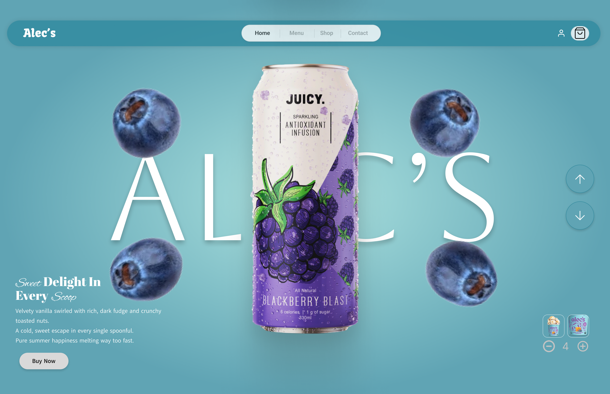
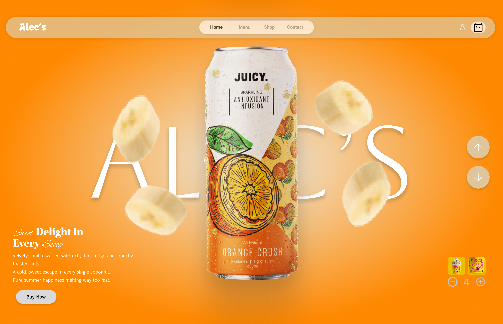
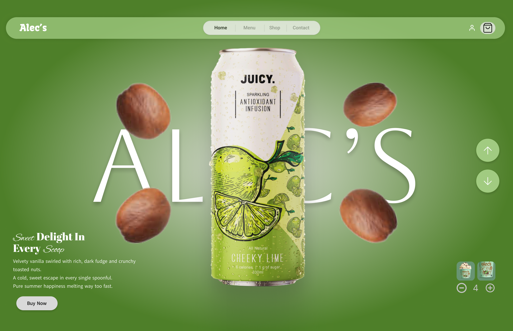

# alecs-figma-prototype

Figma landing page prototype with Smart Animate scroll, adapted from two CC BY 4.0 community templates.

## What I changed
- Built the home page by combining elements from both templates
- Replaced the ice cream products with the juice cans
- Set up the scroll interaction and transitions between screens using Figma's Smart Animate

## Credits

This design is adapted from two Figma Community files, both licensed under
[CC BY 4.0](https://creativecommons.org/licenses/by/4.0/):

- ["Ice Cream Transition"](PASTE-ICE-CREAM-LINK-HERE) by
  [Mustafa Lanewala](https://www.figma.com/files/team/1685943716327107733/resources/community/@mustafalanewala):
  used as the base template, including the "Alec's" name and branding.
- ["Fruit Juice Drink"](PASTE-FRUIT-JUICE-LINK-HERE) by
  [Dixit Pedhadiya](https://www.figma.com/files/team/1685943716327107733/resources/community/@dixitpedhadiya):
  the can artwork.
## Design preview

## Prototype demo

[Watch the Smart Animate scroll demo](demo.mp4)

(My Second UI Design Using Figma.)
